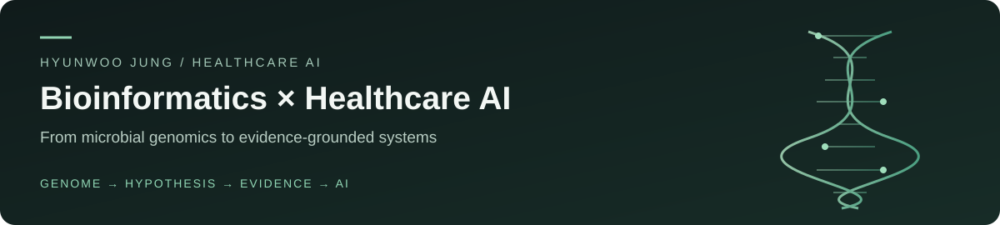

# 정현우 · Hyunwoo Jung

**Bioinformatics × Healthcare AI**

미생물 유전체 연구와 wet-lab 검증에서 출발해, 유전체·의료 AI와 근거 중심 Healthcare RAG/LLM으로 확장해 왔습니다.
데이터의 생물학적 의미, 검증 설계, 답변의 출처와 한계를 함께 다룹니다.

*From microbial genomics and wet-lab validation to genomic/medical AI and evidence-grounded healthcare RAG/LLM.*

[Portfolio](https://hyunwoo-jung-portfolio.vercel.app/) · [LinkedIn](https://www.linkedin.com/in/hyunwoo-jung-b81a73405/) · [Technical Blog](https://velog.io/@ceohwj/series) · [Email](mailto:ceohwj@naver.com)

## Selected work · 문제 정의와 기여

| 프로젝트 | 담당 역할·기여 | 코드·근거 |
| --- | --- | --- |
| **Healthcare RAG / LLM** · 팀 프로젝트 | 복약 안내의 검색·근거·생성 경계를 설계하고, 출처가 맞지 않거나 모호하면 생성을 제한하는 fail-closed 검증과 Backend 연동을 담당했습니다. | [Case study](https://hyunwoo-jung-portfolio.vercel.app/case-studies/healthcare-rag) · [Dosey 코드 미러](https://github.com/ceohwj/Dosey) · [원본 PR](https://github.com/AI-HealthCare-05/AH_05_04/pull/919) |
| **Cancer Genomics ML** · 팀 해커톤 | 전처리·피처 엔지니어링·모델링·앙상블·제출을 팀과 공동 수행했습니다. 동일 변이 profile의 중복 노출 위험을 그룹 기반 검증으로 점검했습니다. | [Repository](https://github.com/ceohwj/cancer-subtype-classification) · [검증 설계](https://github.com/ceohwj/cancer-subtype-classification/blob/develop/README.md) |
| **Chest X-ray Classification** · 개인 프로젝트 | 데이터 감사부터 PyTorch 모델링·OOF 앙상블·threshold 분석까지 수행했습니다. FN/FP trade-off와 Grad-CAM의 marker·border 반응을 검토했습니다. | [Repository](https://github.com/ceohwj/chest-xray-pneumonia-classification-ai) · [Case study](https://hyunwoo-jung-portfolio.vercel.app/case-studies/chest-xray) |
| **CodeLingo AI** · 개인 제품 / AI-assisted | 코딩·데이터·Bioinformatics 학습을 위한 local-first 퀴즈 제품입니다. 제품 범위와 품질 기준을 정하고 AI 도구의 구현 결과를 검토했습니다. 런타임 LLM 서비스는 아닙니다. | [Live demo](https://code-lingo-ai.vercel.app/) · [Repository](https://github.com/ceohwj/code-lingo-ai) · [Case study](https://github.com/ceohwj/code-lingo-ai/blob/main/CASE_STUDY.md) |

## Engineering evidence

Healthcare RAG 팀 저장소에서 제가 작성하고 merge된 변경입니다. 코드 미러와 구분해 원본 PR에서 기여 범위와 검증 기록을 확인할 수 있습니다.

- [PR #919 — Medication retrieval](https://github.com/AI-HealthCare-05/AH_05_04/pull/919): 검색 호출과 의약품 snapshot·출처 추적을 하나의 재현 가능한 경계로 연결.
- [PR #924 — Evidence & runtime assembly](https://github.com/AI-HealthCare-05/AH_05_04/pull/924): citation·provenance가 일치하는 근거만 최종 복약 안내에 연결.
- [PR #926 — Backend integration](https://github.com/AI-HealthCare-05/AH_05_04/pull/926): FastAPI lifespan에서 Guide executor factory를 초기화하고 Backend가 shared port로 접근하도록 연결.

팀 프로젝트의 전체 성과를 개인 단독 성과로 표현하지 않습니다. 의료 AI의 내부 검증·대회 결과와 소프트웨어 테스트는 임상 유효성의 증거로 해석하지 않습니다.

## Research foundation

**Roseovarius sp. CAU 1744 · 석사 연구**

WGS·비교유전체·KEGG 분석에서 기능 가설을 도출하고, PCR·배양·in vitro assay로 증거 수준을 구분해 평가했습니다.
유전자 존재와 기능 입증을 구분하며, DCE 단독 탄소원에서 biomass 증가가 확인되지 않은 결과도 함께 기록했습니다.

[Research case study](https://hyunwoo-jung-portfolio.vercel.app/case-studies/roseovarius-genomics) · [WGS record](https://www.ncbi.nlm.nih.gov/nuccore/JBDOQV000000000) · [16S record](https://www.ncbi.nlm.nih.gov/nuccore/OR766341)

30초 소개 · Interview introduction

미생물 유전체 연구에서 얻은 생물학적 해석과 증거 구분 기준을 의료 AI와 Healthcare RAG로 이어 왔습니다. 개인 의료영상 프로젝트에서는 중복 위험과 오류 비용을 검토했고, 팀 RAG 프로젝트에서는 검색 근거를 검증하고 Backend에 연결하는 경계를 담당했습니다. 점수와 기능 구현뿐 아니라 무엇을 검증했고 어떤 한계가 남았는지 설명하는 엔지니어를 지향합니다.

## Tools in context

- **Genomics & data:** WGS / comparative genomics / KEGG · Python / pandas / NumPy
- **ML & validation:** PyTorch / scikit-learn / CatBoost / XGBoost / LightGBM · grouped CV / OOF / SHAP / Grad-CAM
- **Healthcare systems:** FastAPI / PostgreSQL / Docker · retrieval / citation / provenance / safety validation
- **Product & delivery:** Next.js / React · Git / GitHub / tests / CI / PR review

AI coding tools support implementation; I define scope and acceptance criteria, inspect diffs and test evidence, and retain responsibility for the final result.

더 자세한 의사결정, 검증 결과와 한계는 [포트폴리오](https://hyunwoo-jung-portfolio.vercel.app/)에서 확인할 수 있습니다.
